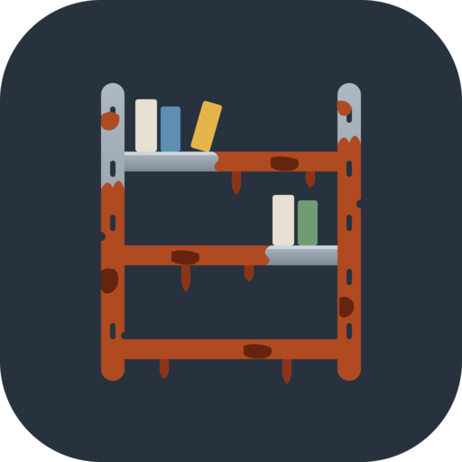

# (T)rustyShelf



(T)rustyShelf is a TV-style launcher for emulators, Steam, Epic and PC games: a shelf
of game boxes you browse with a controller. It's a fork of
[Boxshelf](https://github.com/sassiestrhihno/boxshelf-beta) that adds PC games on
Linux (see [t-rustyshelf](https://github.com/GGStonks/t-rustyshelf)). This image runs
it as a Wolf app, one (T)rustyShelf per Wolf profile.

## How it works

- **Compositor:** (T)rustyShelf runs inside a nested KWin (Wayland, with Xwayland),
  not Sway or gamescope. (T)rustyShelf needs a stacking window manager: it keeps
  itself on top, fades in and out, and covers a game while it closes. KWin
  behaves like a Plasma desktop does. (T)rustyShelf itself uses X11 for the same
  reason.
- **Mouse-look in games:** a nested KWin hears only where the cursor is, not how
  far the mouse moved, until it locks the cursor in Wolf's compositor (KWin does
  that on Right Ctrl). Without it a game that captures the mouse (Minecraft's
  camera, first-person games) doesn't move, while menus work. `pointer-lock`
  presses Right Ctrl once when (T)rustyShelf is up, through the session's own Wolf
  keyboard. Right Ctrl unlocks the cursor, and locks it again.
- **Session:** (T)rustyShelf is KWin's only session. Quitting (T)rustyShelf (quick menu,
  then Power, then Exit) closes the stream.
- **Emulators:** built on `base-emu`, so Dolphin, Cemu, PCSX2, RPCS3 and
  RetroArch are in the image. At start the AppImages are linked into
  `~/Applications`, where (T)rustyShelf finds them. Folders listed in
  `TRUSTYSHELF_EMULATOR_DIRS` (separated by `:`) are linked too.
- **The app:** the image doesn't contain (T)rustyShelf. Wolf mounts the host's
  `TrustyShelf.AppImage` read-only at `/opt/trustyshelf/TrustyShelf.AppImage`, so every
  profile runs the same build as the host (an official release from
  sassiestrhihno/boxshelf-beta or a build of your own), and updating it on the
  host updates every profile. Each profile runs its own copy of it,
  `~/TrustyShelf/app/TrustyShelf.AppImage` (a reflink on btrfs), so (T)rustyShelf's
  own updates work in Wolf too: see below. It's unpacked once per version into
  `/etc/wolf/trustyshelf/app-cache` (shared by every profile) and started from
  there, instead of being unpacked into `/tmp` on every start.

## PC games (Epic, Windows games)

(T)rustyShelf's Linux PC support (Settings, then PC games) shows every folder of the
PC games folder as a game: a Linux one runs as it is, a Windows one through
Wine or Proton. It also shows the whole Epic library through legendary, with
uninstalled games greyed out. The image adds `legendary`, `umu-run` (pinned,
checksum-verified releases) and Ubuntu's Wine (32 and 64 bit). The Proton
builds come from the host's `compatibilitytools.d` and `/usr/share/steam`.

For example (`host/site.json` names the real folders):

| Folder | What |
|---|---|
| `/srv/games/PC` | the PC games every account shares |
| `/srv/games/accounts/<name>/Prefixes` | the account's Wine prefixes, one per game, named after it |
| `/srv/games/accounts/<name>/Games` | the account's own copies (a folder with the same name wins over the shared one) |
| `/srv/games/accounts/<name>/Home` | the home the account's Linux games get: their saves and settings, Citron's data |

They're mounted at the same paths as on the host, so prefixes and settings work
the same everywhere. `TRUSTYSHELF_PC` in the Wolf entry names the account's folders.
Each account keeps its own Epic sign-in in `~/TrustyShelf/data/legendary`, and its
own programs and Wine settings per game (`pc.programs`, `pc.run`) in (T)rustyShelf's
settings. The umu runtime (about 0.5 GB) is downloaded once into
`/etc/wolf/trustyshelf/umu` and shared by every profile.

These need extra container permissions: `SYS_ADMIN`,
unconfined seccomp and AppArmor (the Steam Linux Runtime uses bubblewrap), and
10240 open files (esync).

## What lives where: the image or the AppImage

The image only provides the place (T)rustyShelf runs in. Everything (T)rustyShelf does
(its shelves, settings, PC games, Epic support, covers, the Exit
button) comes from the host's `TrustyShelf.AppImage`. Replace that file and the
next (T)rustyShelf session in Wolf runs the new version: no image rebuild, no
config change. A session that's already open keeps its version until it's
closed. Each new version is unpacked once, about 0.5 s on its first start.

(T)rustyShelf can also update itself in a profile: Settings, then System, then
"Automatically update on startup" (on in a new profile when the host's settings
have it on). At start it downloads a newer release over the profile's copy and
restarts; the launch wrapper starts the new version in the same stream, with
its flags (Electron's own restart would drop them, and end the stream). The
update is that profile's only. When the host's AppImage changes later than the
profile's copy, the next start copies the host's over it. Unpacked versions no
profile has started for a day are removed from the cache.

The image and the Wolf entry provide what (T)rustyShelf finds around it:

- KWin, Xwayland and the libraries Electron needs
- `legendary`, `umu-run` and Wine
- the emulators from `base-emu`
- the start-up script: the profile's AppImage copy, settings seed, the account's PC folders, box-art seed, emulator links
- the launch wrapper: Chromium flags, the file dialog's size, the unpack cache, restarts after an update
- the mounts: games, the account's folder, Proton builds, caches

These only need changing when a new (T)rustyShelf feature needs something new from
outside the AppImage, such as another tool or another folder.

`host/wolf-entries.py` writes the (T)rustyShelf entry into every account profile of
Wolf's `config.toml` (the accounts and folders come from `host/site.json`; copy
`host/site.example.json`), with the account's folders and the few mounts of its
Heroic app that lay a shared folder over part of a game (mods, saves). Run
it, then restart Wolf, while nobody is streaming.

## Each profile's data

Wolf gives each profile its own home (`/etc/wolf/profile-data/<profile>/WolfTrustyShelf`).
(T)rustyShelf keeps its settings, history and caches in `~/TrustyShelf` there.

On a profile's first start its settings are copied from a seed made on the
host, `/etc/wolf/trustyshelf/seed-config.json`. The seed is the host's (T)rustyShelf
settings without its accounts (RetroAchievements, ScreenScraper, API keys) and
with Steam turned off (there's no Steam in this image). Each profile can sign in
to its own accounts in (T)rustyShelf's settings.

Shared between all profiles (see `assets/wolf.config.toml`):

| What | Access |
|---|---|
| The art library, guides and magazines | read-write |
| Songs and custom themes | read-only |
| The Switch game folders | read-only, at the same paths as on the host |
| The PC games folder | read-write (Epic games install there) |
| The account's own folder (`/srv/games/accounts/<name>`) | read-write, that account only |

## Building

```sh
docker build \
  --build-arg BASE_APP_IMAGE=ghcr.io/games-on-whales/base-emu:edge \
  -t trustyshelf:latest apps/trustyshelf/build
```

Then refresh the seed (`/etc/wolf/trustyshelf/seed-config.json`: the host's
(T)rustyShelf settings without its accounts, see above) and copy `assets/icon.png`
to `/etc/wolf/icons/trustyshelf.png`.
